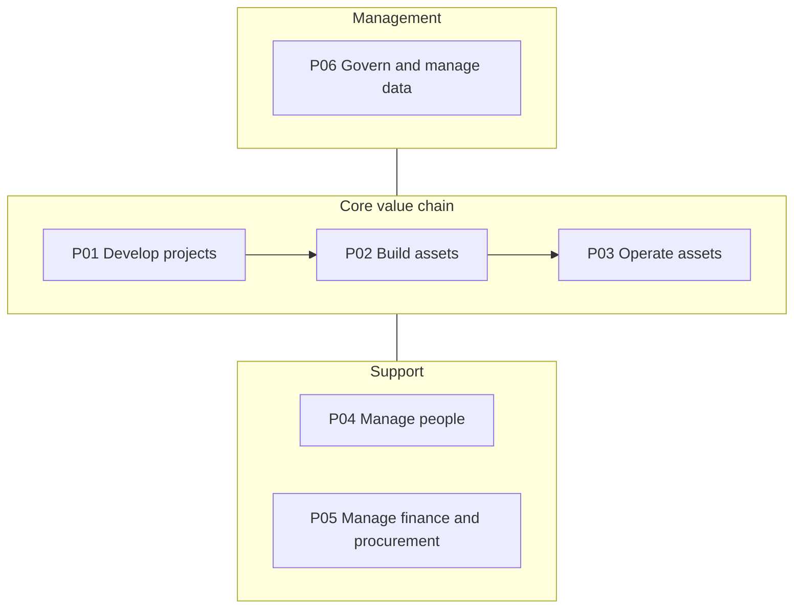
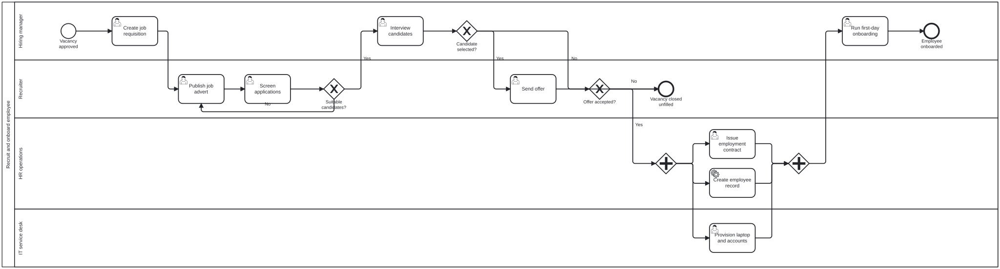
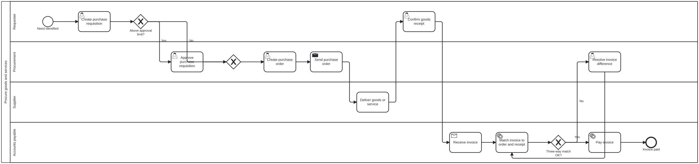
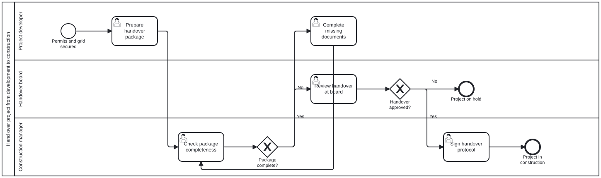
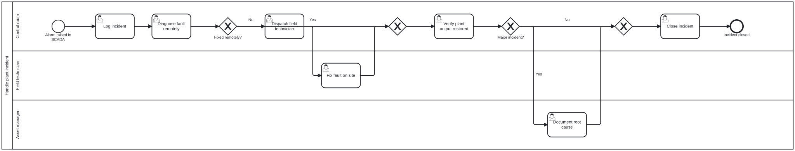
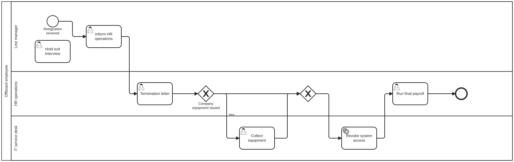

# Process architecture and BPM governance

A working example of enterprise process management for a fictional wind and solar developer, Aurora Renewables. It covers a process house from level 1 to level 3, a governance model with owners and a release lifecycle, BPMN 2.0 models, and a checker that enforces the modelling rules and governance rules in CI.

The company and every process in it are made up. The methods are the ones I use in process transformation work: one owner per end-to-end process, a release lifecycle, modelling conventions that can be checked, and a capability map that shows where to invest.

## What is in it

| Part | Files |
|---|---|
| Process house, levels 1-3, with owners, status, review dates, capabilities and systems | [docs/process-architecture.md](docs/process-architecture.md), [architecture/process_catalog.yaml](architecture/process_catalog.yaml) |
| Governance model: roles, RACI, lifecycle, cadence, KPIs | [docs/governance-model.md](docs/governance-model.md) |
| BPMN modelling conventions (16 checked rules) | [docs/modelling-conventions.md](docs/modelling-conventions.md) |
| Five end-to-end processes in BPMN 2.0 | [models/](models) (standard BPMN 2.0 XML; open in bpmn.io or Camunda Modeler, or import into a BPM suite) |
| Business capability map with maturity and heat map | [architecture/capability_map.yaml](architecture/capability_map.yaml), heat map in the report |
| Playbook for moving a process repository to a new BPM platform | [docs/migration-playbook.md](docs/migration-playbook.md) |
| Checker: BPMN rules, governance rules, dashboard, migration inventory | [src/bpmtools](src/bpmtools) |
| Latest governance report | [reports/governance_report.md](reports/governance_report.md) |

## Process house



Six process areas, eight process groups, 21 end-to-end processes, each with one owner role.

## BPMN models

| Process | Status | Diagram |
|---|---|---|
| Recruit and onboard employee | released |  |
| Procure goods and services (procure to pay) | released |  |
| Hand over project from development to construction | released |  |
| Handle plant incident | released |  |
| Offboard employee | in review |  |

Each model is defined in a short YAML file in `models/src/` and turned into BPMN 2.0 XML with diagram layout by `python -m bpmtools build-models`. The files import without warnings into bpmn.io, and the diagrams above were exported from it. The offboarding model is in review and still has open findings on purpose, to show what the checker catches before release.

## The checker

```bash
pip install -e ".[dev]"
python -m bpmtools check                  # catalog + models -> reports/
python -m bpmtools lint path/to/any.bpmn  # check any BPMN 2.0 export
pytest                                    # 12 tests
```

It runs two sets of rules:

* **Model rules** (BPM001-BPM016) on any BPMN 2.0 file: start and end events, no dead ends or endless loops, every gateway flow labelled, verb + object task names, question-style gateway names, lanes, owner and version in the documentation, matching parallel splits and joins.
* **Governance rules** (GOV001-GOV009) on the catalog: owner from the role list, valid lifecycle status, review date not passed and not more than 12 months out, model file present and linked by catalog ID, released models free of errors, every process linked to a capability, and possible duplicates by name.

CI fails when a **released** process breaks a rule. Drafts and processes in review can have findings, because the review is where they get fixed.

### Current dashboard

| Measure | Value |
|---|---|
| Processes | 21 (15 released, 3 draft, 2 in review, 1 retired) |
| Owner coverage of live processes | 95% |
| Overdue reviews | 2 |
| Live processes modelled in BPMN | 25% |
| Models without errors | 4 of 5 |
| Blocking findings on released processes | 0 |

What the checker found in the catalog:

* **Possible duplicate:** "Onboard and recruit new employees" (draft) covers the same work as the released "Recruit and onboard employee". One of them should be retired.
* **No owner:** "Manage data quality" is a draft with nobody accountable.
* **Overdue reviews:** "Obtain permits" and "Manage supplier master data".
* **Offboarding model, in review:** an exit interview task with no connections, a gateway flow without a label, a task named as a noun ("Termination letter"), and an unnamed end event.

The capability heat map puts permitting, grid connection and data quality management at the top: they matter most to the strategy and are the least mature. Risk management has no documented process at all.

## Layout

```
architecture/   process catalog, governance settings, capability map
models/src/     process definitions (YAML)
models/         BPMN 2.0 files built from them
docs/           architecture, governance model, conventions, migration playbook, diagrams
src/bpmtools/   generator, BPMN checker, catalog checks, report
reports/        governance report, findings, heat map, migration inventory
tests/          12 tests
```

## License

MIT
