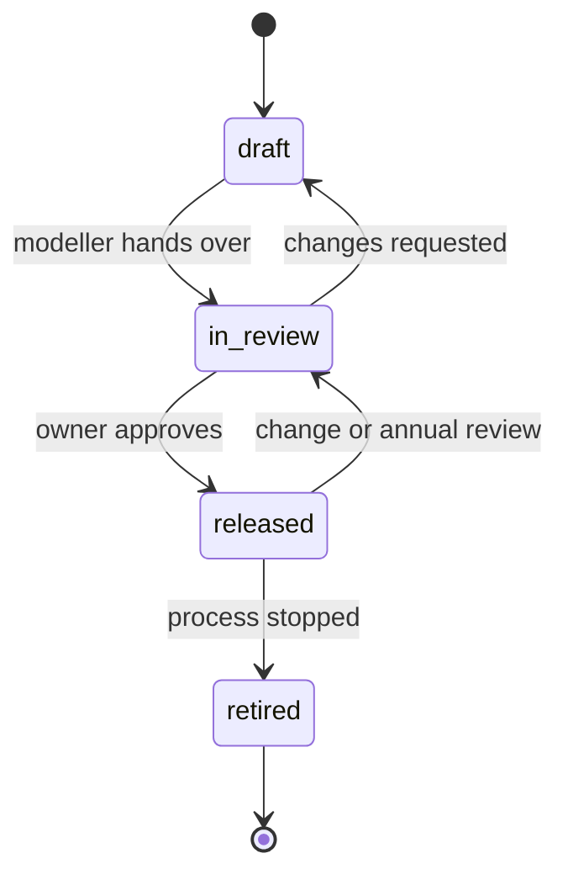

# BPM governance model

How processes are owned, changed and kept current at Aurora Renewables (fictional). The checker in `src/bpmtools` enforces the parts of this model that a machine can check. The rest is done by people in the review cadence below.

## Roles

| Role | Accountable for | Typical holder |
|---|---|---|
| Process owner | Design, performance and compliance of one end-to-end process. Approves releases. Owns the process KPIs. | Head of a function (one owner per level-3 process) |
| Process steward | Day-to-day upkeep of the model and documents. Collects change requests. Prepares reviews. | Senior team member in the owning function |
| Process modeller | Models changes in BPMN to the conventions. Runs the checker before handing over for review. | Trained modeller in the function or the process team |
| Process excellence team | Runs the repository, the conventions, the checker and the governance board. Trains modellers. | Central BPM team |
| Governance board | Decides on changes that cross process areas, settles ownership disputes, approves the architecture. | Process owners of the level-1 areas, chaired by the process excellence lead |

RACI for the main activities:

| Activity | Owner | Steward | Modeller | Excellence team | Board |
|---|---|---|---|---|---|
| Request a process change | A | R | C | I | |
| Model the change | A | C | R | C | |
| Check against conventions | I | I | R | A | |
| Approve release | A | R | I | C | |
| Change the process architecture (levels 1-2) | C | I | | R | A |
| Annual review | A | R | C | C | I |

R responsible, A accountable, C consulted, I informed.

## Lifecycle

| Status | Meaning | Rules |
|---|---|---|
| draft | Work in progress, not valid for anyone | No checks block a draft |
| in_review | Waiting for owner approval | Checker findings are listed for the reviewer |
| released | The valid way of working | No checker errors allowed. Review at least every 12 months |
| retired | Kept for history, not valid | No review date |

## What the checker enforces

| Rule | Check |
|---|---|
| GOV001 | Every process has an owner from the list of defined roles |
| GOV002 | Status is one of the lifecycle values |
| GOV003 | Review date has not passed |
| GOV004 | Linked BPMN model exists and carries the same catalog ID |
| GOV005 | A released process links to a model without errors |
| GOV006 | Every process realises at least one known capability |
| GOV007 | No two live processes have nearly the same name (possible duplicate) |
| GOV008, GOV009 | Released processes have a review date, no more than 12 months out |

Model rules (BPM001-BPM016) are in [modelling-conventions.md](modelling-conventions.md).

CI runs `python -m bpmtools check` on every change. It fails when a **released** process breaks a rule. Drafts and processes in review may have findings, since that is what the review is for.

## Cadence

| When | What | Who |
|---|---|---|
| Every change | Checker run in CI, owner approval for release | Modeller, owner |
| Monthly | Governance report: overdue reviews, missing owners, open findings, duplicates | Excellence team to owners |
| Quarterly | Governance board: architecture changes, capability gaps, cross-area issues | Board |
| Yearly | Full review of every released process | Owner and steward |

## Governance KPIs

| KPI | Target | Where |
|---|---|---|
| Owner coverage of live processes | 100% | `dashboard.json` → `owner_coverage_pct` |
| Overdue reviews | 0 | `overdue_reviews` |
| Released models without errors | 100% | `models_without_errors` |
| Share of level-3 processes modelled in BPMN | grows each quarter | `modelled_in_bpmn_pct` |
| Possible duplicates open | 0 | GOV007 findings |
