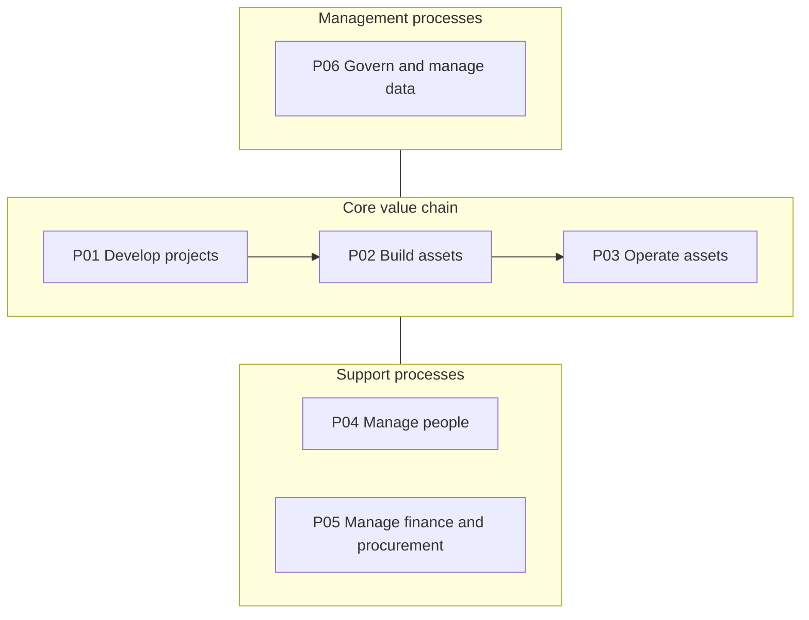

# Process architecture

The process house of Aurora Renewables (fictional), a company that develops, builds and runs wind and solar parks. The full catalog with owners, status, review dates, capabilities and systems is in [`architecture/process_catalog.yaml`](../architecture/process_catalog.yaml).

## Levels 1 to 3

| L1 | L2 | L3 end-to-end process | Owner | Status | BPMN |
|---|---|---|---|---|---|
| P01 Develop projects | Originate and secure sites | Screen and secure land | Head of Origination | released | |
| | | Manage landowner agreements | Head of Origination | released | |
| | Permit and design | Obtain permits | Head of Permitting | released | |
| | | Secure grid connection | Head of Grid | in review | |
| | | Hand over project from development to construction | Head of Project Development | released | [model](../models/project_handover.bpmn) |
| P02 Build assets | Construct | Plan construction | Head of Construction | released | |
| | | Manage construction site | Head of Construction | released | |
| | | Commission and hand over plant | Head of Construction | draft | |
| P03 Operate assets | Operate and maintain | Handle plant incident | Head of Asset Operations | released | [model](../models/plant_incident.bpmn) |
| | | Plan preventive maintenance | Head of Asset Operations | released | |
| | | Report plant performance | Head of Asset Operations | retired | |
| P04 Manage people | Hire to retire | Recruit and onboard employee | Head of Talent Acquisition | released | [model](../models/recruit_to_onboard.bpmn) |
| | | Onboard and recruit new employees | HR Operations Lead | draft | |
| | | Manage employee changes | HR Operations Lead | released | |
| | | Offboard employee | HR Operations Lead | in review | [model](../models/offboard_employee.bpmn) |
| P05 Manage finance and procurement | Procure to pay | Procure goods and services | Head of Procurement | released | [model](../models/procure_to_pay.bpmn) |
| | | Manage supplier master data | Head of Procurement | released | |
| | Record to report | Close the month | Head of Accounting | released | |
| | | Manage contracts | General Counsel | released | |
| P06 Govern and manage data | Process and data governance | Manage process lifecycle | Process Excellence Lead | released | |
| | | Manage data quality | (none) | draft | |

## Design principles

1. **End to end, not by department.** A level-3 process runs from a trigger to an outcome the customer of the process cares about, across every role involved. "Procure goods and services" starts with a need and ends with a paid invoice, not at the edge of the procurement team.
2. **One owner per level-3 process.** Shared ownership means no ownership. The owner is a role, so the model survives reorganisations.
3. **One place for each process.** If two entries describe the same work, one is retired. The checker flags names that overlap (GOV007). In this catalog, "Onboard and recruit new employees" (draft) duplicates "Recruit and onboard employee" (released), a typical result of two teams documenting the same process.
4. **Processes realise capabilities.** Each level-3 process links to the capabilities in [`capability_map.yaml`](../architecture/capability_map.yaml). That shows which capabilities have no documented process, and where to invest first.
5. **Level 4 stays out of BPMN.** Work instructions change often and belong in checklists linked from the task, not in the process model.

## Target operating model view

| TOM dimension | Where it is described |
|---|---|
| Processes | This page, the catalog and the BPMN models |
| Organisation and roles | Lanes in the models, owner roles in the catalog, [governance model](governance-model.md) |
| Systems | `systems` per process in the catalog, systems per capability in the heat map |
| Governance | [governance-model.md](governance-model.md), the checker in CI |
| Performance | Governance KPIs in the dashboard. Process KPIs are owned by each process owner |
